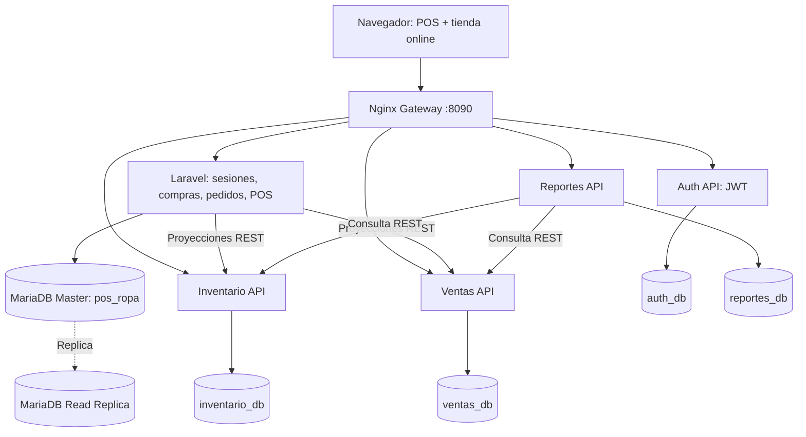

# Arquitectura y guion para presentación (10 minutos)

La flecha de Laravel a los microservicios indica **sincronización de proyecciones después de las operaciones comerciales**. No implica que esos servicios sean hoy la autoridad sobre las ventas o existencias reales. La replicación Master/Réplica MariaDB se mantiene entre servidores de base de datos, no entre todas las bases por separado.

## Guion propuesto

- 0:00–1:00: problema, objetivo, arquitectura general y un único SIS_ROPA.
- 1:00–2:30: administración: productos, tallas/colores, roles, proveedores.
- 2:30–4:00: venta POS y comprobante imprimible / PDF.
- 4:00–5:30: tienda, carrito, checkout Stripe **modo prueba**, QR, seguimiento.
- 5:30–7:00: Docker Compose, cuatro microservicios, Nginx, estado de réplicas.
- 7:00–8:30: prueba de autenticación JWT y REST; sincronización POS y consulta de reportes.
- 8:30–9:30: APIs externas demostradas y documentación endpoints.
- 9:30–10:00: pruebas, limitaciones reconocidas y cierre.

### Evidencias sugeridas

Captura de `docker compose ps -a`, capturas del flujo de venta y del checkout, resultado de `prueba-distribuida.ps1`, resultado de `probar-sincronizacion-pos.ps1`, captura de `SHOW SLAVE STATUS\\G`, comprobante PDF, README y documentación REST.

## Pendientes académicos críticos antes de declarar ambos proyectos completados

1. El documento 1 exige microservicios independientes y cada servicio con acceso exclusivo a su BD. Las proyecciones REST ayudan a demostrar separación, pero **la escritura de inventario/ventas real todavía vive en Laravel**.
2. El documento 2 exige negocio distinto del elegido para el documento 1. Presentar ropa para ambos **no cumple literalmente ese punto**; requiere aclaración/aceptación docente.
3. Falta demostrar imagen real de cada uno de los 20+ productos y almacenamiento Cloudinary si se evalúa con máxima nota.
4. Falta demostrar el despliegue completo distribuido públicamente; Docker local no equivale a hosting público.
5. Configurar OpenWeather en el Docker si se utilizará como tercera API externa, y webhook Stripe para notificaciones confiables.
